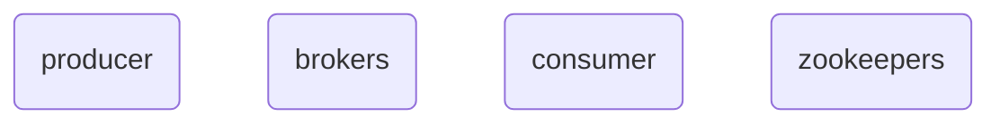

[[cs_learning]]
link: https://www.youtube.com/watch?v=jY02MB-sz8I&list=PLa7VYi0yPIH2PelhRHoFR5iQgflg-y6JA&index=5
name:
topic:
author: confluent
tags:
github:

producers (write, stored on broker disks)-> brokers <-(polls broker to read data) consumers

zookeepers are used for consensus on - distributed consensus manager
acl are stored in zk
when a broker fails, detection and recovery zk -> election of new leaders
cluster management

decouples producers and consumers
slow consumers do not affect producers
adding consumers without affecting producers
failure of consumer does not affect system

topic is a collection of related messages or events, its a durable log ie needs to be stored on disk. the broker that the partition lives on is just a computer and if r/w messages is happening there, can't scale forever.
so topics are broken into pieces, partitions are each allocated to a sepeate brokers

partition is similar to a log

ordering in partition is always there but not necessarily in topic
the partition is stored as multiple segments (similar to rolling files)

record
- key - string / int / compound serialised obj
- value - domain obj
- headers - metadata
- timestamp

broker responsibilites
- manage partitions
- takes ip from producers, updates partitions, gives op to consumers
- broker replication factor -> leader, followers

how does a producer know which partition to write a message to ?
- no key ? round robin
- key ? hash(key)%partitions i.e. messages with the same key go the same partition which means they are strictly ordered all the time

consumers poll, consumer offset that keeps track of the last message read is stored in a special topic named `consumer_offsets`

every consumer is a consumer group in kafka

partition leadership
- four brokers, one topic
- leaders are the r/w location, in some versions r can also happen in followers

no required relation between number of brokers and number of partitions
events are immutable, timeout -> 1 week -> retention period global or per topic

producer acks
- no
- leader
- all 

delivery gurantees
- some lost -> at most once
- duplicates -> at least once
- exactly once 

atomic broadcast problem -> exactly once delivery is impossible

exactly once
- strong transactional guaran
- exactly once PROCESSING

consumer gorups
- consumer rebalances happen automatically

compacted topic -> most recent version of each event in the topic

