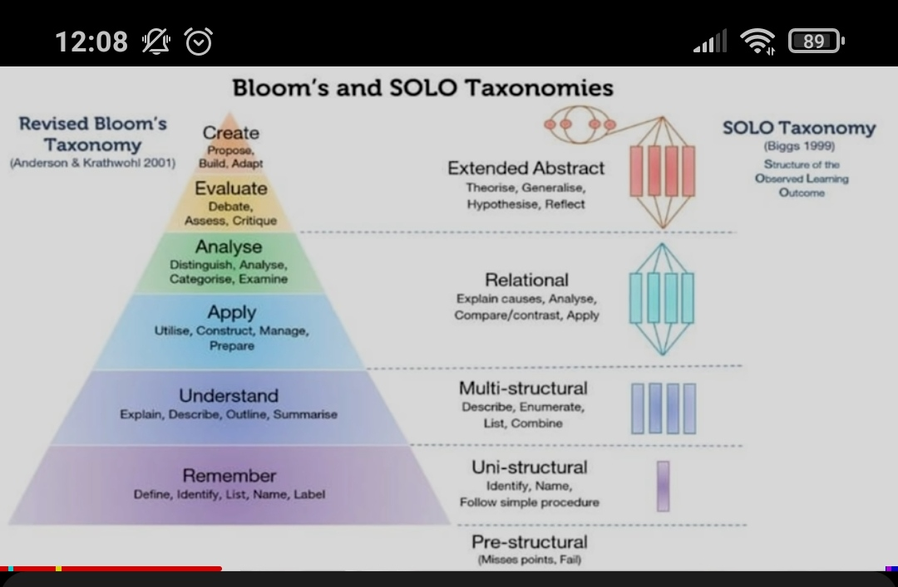

Justin súng train to be genius
 Qualities of Genius: strong memory and deep understanding, application 

4:15 How to have a good memory. Start with good informational encoding

4:54 Deepen understanding by deep processesing (connecting ideas to other related ideas)

deep processing helps with encoding as well

6:59 Higher order learning 
thoughts about the info, 
7:58 stages/orders of learning
 

1 priorities which relationship is more important that another
2 more relationships and groups, compare with other info, patterns 
3 applied info / get info related to each other
4 info in isolation 

14:52 Steps we can take to improve
short term
- Analyze which level of learning currently at
- Go up a level

long term
Prestudy structures - class or lectures, prepping for learning interval like reading before lecture
 Delay note-taking
 increase cognitive load tolerance
 Critical reflection of technique
